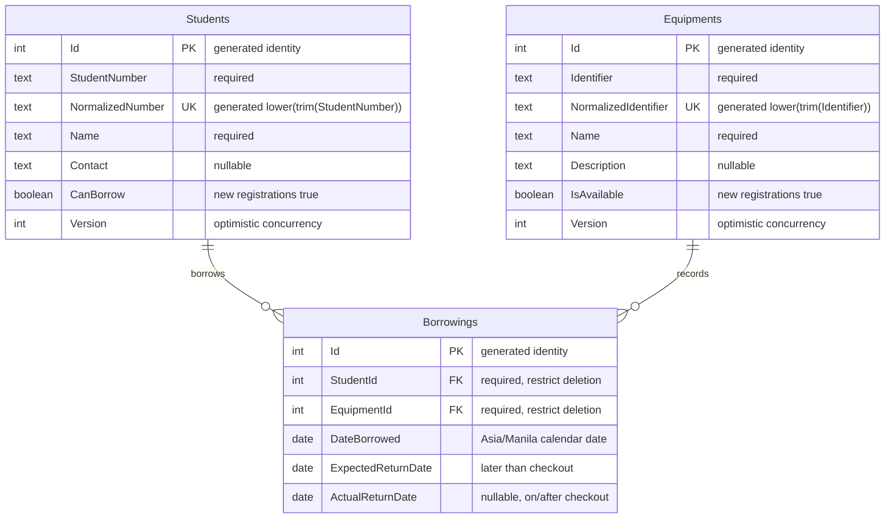

# PostgreSQL relational schema

`Status` is derived from `ActualReturnDate`: null is Active, otherwise Returned. It is not a separately editable column and cannot disagree with the return date. The model deliberately keeps one borrowing per physical item; no checkout parent is necessary for atomicity.

## PostgreSQL constraints and migration

- Identity primary keys use PostgreSQL sequences; client code never computes `Count + 1`.
- Required identifiers/names are NOT NULL and have nonblank CHECK constraints. Optional contact/description are null or nonblank.
- Generated normalized identifiers use PostgreSQL `lower` and `btrim` with the full .NET Unicode whitespace set. Unique indexes enforce case-insensitive, trimmed uniqueness, including direct SQL attempts. Database collation determines letter case equivalence.
- Foreign keys require exactly one existing student and physical item, with restricted deletion.
- Unique filtered index `IX_Borrowings_EquipmentId` applies where `ActualReturnDate IS NULL`: at most one active borrowing per item.
- CHECK constraints enforce expected date > checkout and actual date >= checkout.
- `Version` is an EF concurrency token for student/equipment edits. Application transactions serialize writers before reading rules and apply the fixed three-active-item limit. Descriptive editing never changes availability or borrowing dates.

Apply the committed `PostgreSqlInitial` migration using the README command. It creates the three tables, constraints, indexes, and one-time fictional seed. Migration history is recorded in `__EFMigrationsHistory`. The old SQLite migration is preserved in earlier Git commits and is not applied to PostgreSQL. No SQLite data transfer is required by the handout.

Reproduction and fresh-connection inspection queries are in [database-queries.sql](database-queries.sql). Verification deliberately rejects bad foreign keys, normalized duplicates and a second active loan in a unique disposable database. The failure seam runs after actual SaveChanges SQL but before commit, and compares every persisted field before/after using fresh contexts. See [verification.md](verification.md).
